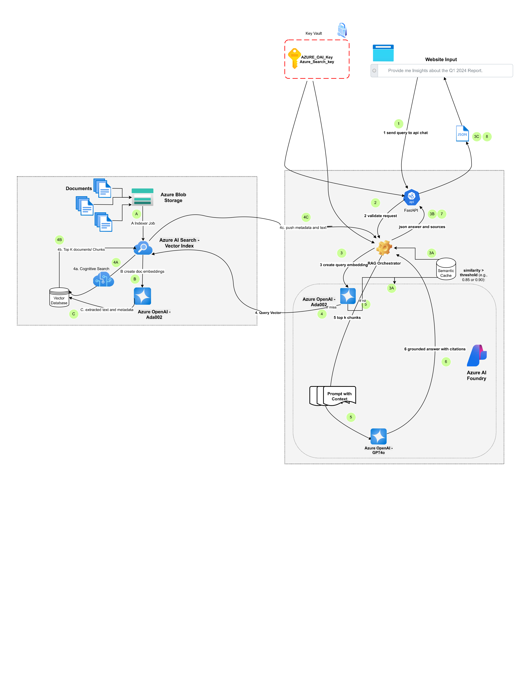

# Ottawa GenAI Research Assistant

A retrieval-augmented generation (RAG) assistant for the City of Ottawa Economic Development team. Analysts ask questions in plain English and get grounded answers, summaries and charts from the City's Economic Development Update reports (Q1 2022 – Q4 2025), with a citation for every answer.

Built as a proof of concept in the Algonquin College AI Software Development program, Fall 2025 – Winter 2026.

## Authorship

I designed and built this proof of concept (Sep 2025 – Feb 2026). The City of Ottawa team repository was initialised from this codebase in March 2026; I then added PDF citation highlighting and the Azure AI Search setup guide there.

## What it does

- **Q&A with citations:** hybrid (vector + keyword) retrieval over report chunks, answers grounded in the retrieved text, sources shown with each answer
- **Document pipeline:** PDF upload, text extraction (PyMuPDF), recursive chunking, embedding and indexing
- **Several search engines behind one interface:** Azure AI Search, local SQLite hybrid search (RRF) and vectorless page-level search (PageIndex)
- **Answer quality checks:** LLM-as-judge evaluation across several dimensions, and a benchmark module for comparing retrieval strategies and models
- **Reports and analysis:** charts and summaries generated from retrieved data, export to PDF
- **Admin console:** data sources, ingestion status, users, prompts and settings
- **Sign-in:** Microsoft Entra ID (MSAL) in the frontend, JWT in the backend
- **Local models:** optional Ollama support for running without Azure

## Architecture



Documents go to Azure Blob Storage, are embedded with Azure OpenAI and indexed in Azure AI Search. A FastAPI RAG orchestrator embeds each query, retrieves the top chunks, builds the prompt and calls GPT-4o, then returns the answer with its sources. Keys are held in Azure Key Vault. Details: [docs/architecture/system-architecture.md](docs/architecture/system-architecture.md).

## Tech stack

| Layer | Technologies |
|---|---|
| Backend | Python, FastAPI, SQLAlchemy (async), Alembic, Pydantic, PyMuPDF |
| AI and search | Azure OpenAI (GPT-4o, embeddings), Azure AI Search, Ollama |
| Frontend | React, TypeScript, Vite, Tailwind CSS, Radix UI, Zustand, Recharts, i18next |
| Auth | Microsoft Entra ID (MSAL), JWT |
| Storage | Azure Blob Storage, PostgreSQL or SQLite |
| Delivery | Docker, Docker Compose, GitHub Actions |

## Run locally

Requirements: Python 3.12+, [uv](https://docs.astral.sh/uv/), Node.js 18+, and Azure OpenAI / Azure AI Search keys (or Ollama for local models).

Backend:

```bash
cd backend
cp .env.example .env
uv sync
uv run uvicorn app.main:app --reload
```

Frontend:

```bash
cd frontend
npm install
npm run dev
```

Or run both with Docker:

```bash
docker compose up --build
```

The API runs on http://localhost:8000 (docs at `/docs`).

## Tests

```bash
cd backend
uv run pytest
```

```bash
cd frontend
npm test
```

## License

[Apache 2.0](LICENSE)
